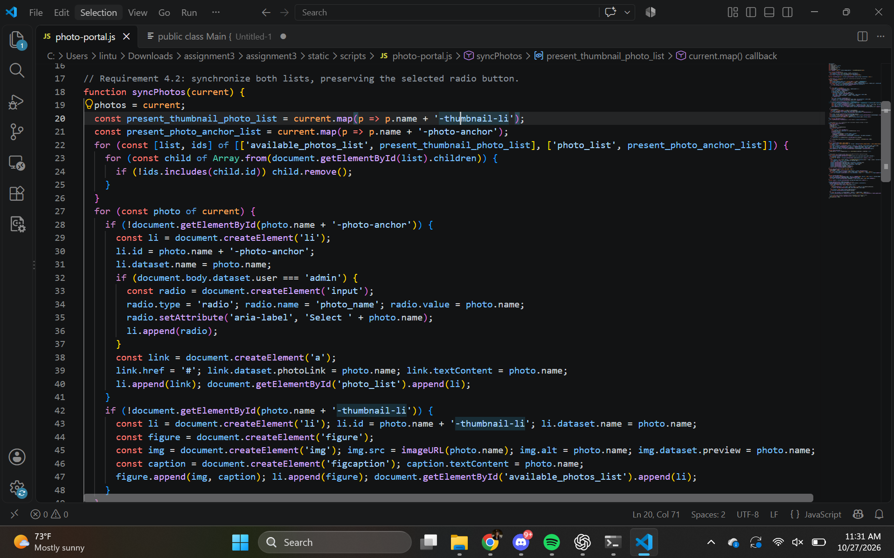
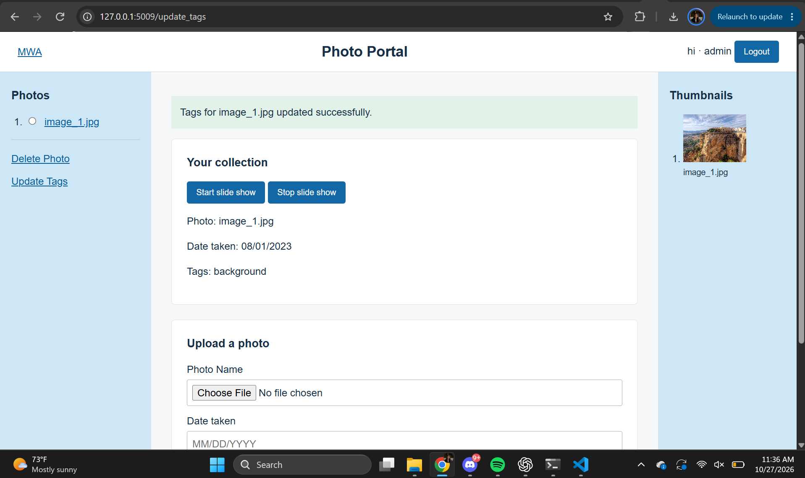
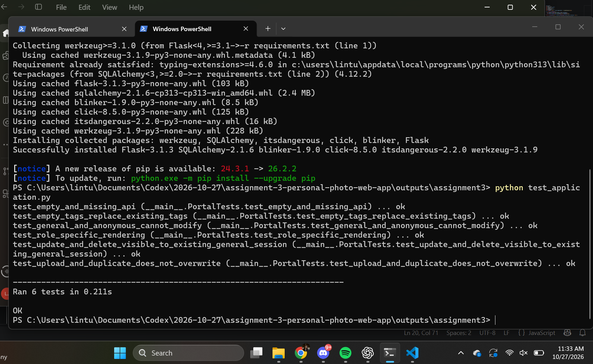

# Assignment 3 reflection - draft for personalization

The requirement with the most coordination involved was keeping an already-open general-user view synchronized after an administrator deleted a photo. Removing a database record is only one part of that behavior. The browser also keeps a photo list, a thumbnail list, displayed metadata, and potentially a slideshow image. Those pieces can become inconsistent when another session changes the backend. The central implementation challenge was therefore deciding how each asynchronous response should update the browser without losing useful state, such as the administrator's selected radio button.

The solution uses the existing five-second polling idea from the starter. Each successful request to the photos endpoint supplies the current authoritative collection. The JavaScript builds two arrays containing the identifiers that should still exist, one for photo links and one for thumbnails. It then iterates over a snapshot of each list's children and removes nodes whose identifiers no longer appear. Creating an array snapshot matters because removing elements while traversing a changing collection can otherwise skip an element. New photos are added afterward, while existing elements remain in place. Metadata is read from the latest collection when a link is clicked, which also prevents updated tags from being hidden behind an old event handler.

Another important issue was coordinating slideshow timers with network requests. Clearing a timer alone does not invalidate a request that has already started. The implementation therefore combines a running flag, a stored timeout handle, and a generation counter. Pressing Stop changes the generation, so an older response cannot restart the slideshow. Repeatedly pressing Start also invalidates the previous run. The slideshow requests current photos before each display cycle and schedules its next cycle after three seconds. This makes it possible to handle an empty collection and avoid continuing indefinitely with a stale photo array.

Testing covered both the backend and the browser. Six integration tests verified empty API responses, duplicate protection, replacement of tags, deletion, role-specific rendering, and rejection of unauthorized changes. The duplicate test compared the stored bytes before and after a second upload, rather than checking only a status message. Browser verification confirmed that current tags appeared in the modal, updated text appeared in photo details, and the slideshow advanced and then remained stopped. A Windows cleanup error also revealed that the test database engine needed to release its connections before the temporary directory could be removed. These checks illustrate why visible success messages should be supported by checks of persisted data and asynchronous behavior.

## Screenshot 1 - Relevant code

The actual list-removal excerpt from `static/scripts/photo-portal.js`, displayed in a local code evidence page.

## Screenshot 2 - Working result

The admin page after updating image_1.jpg, showing the success status and the replacement tags in photo details. Test images are simple generated fixtures, not personal photographs.

## Screenshot 3 - Testing

Captured browser rendering of the actual output from `python test_application.py`, showing all six integration tests passing.

